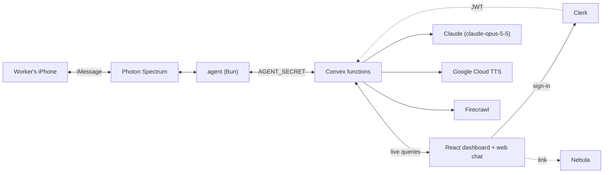

# ezworkspace

**Falling behind on AI is no longer a reason to let someone go. ezworkspace makes catching up part of the job.**

ezworkspace brings existing workers and new hires into AI-era work, as a cheaper, faster alternative to firing, re-hiring or courses. Workers text a private AI coach. Their employer signs a Compact before seeing anything. By Vi, SJSU Responsible Computing Club.

## The problem

- 57% of workers hide their AI use or present AI output as their own ([HRGrapevine](https://www.hrgrapevine.com/us/content/article/2025-05-02-covert-use-of-artificial-intelligence-at-work-poses-risk-study-finds), [MBS](https://www.mbs.edu/2025-impact-report/impact-stories/Global-study-reveals-trust-of-AI-remains-a-critical-challenge)).
- 52% of US workers are worried about AI at work ([Pew](https://www.pewresearch.org/social-trends/2025/02/25/u-s-workers-are-more-worried-than-hopeful-about-future-ai-use-in-the-workplace/)).

Our bet (an assumption): coaching people inside their own workflow beats firing, re-hiring or AI courses on cost and time. Replacing one clerk costs $24.6k–$98.4k, half to twice the BLS median salary ([Gallup](https://www.gallup.com/workplace/247391/fixable-problem-costs-businesses-trillion.aspx), [BLS](https://www.bls.gov/ooh/office-and-administrative-support/bookkeeping-accounting-and-auditing-clerks.htm)). A bootcamp costs ~$14k and 14 weeks per person ([Course Report](https://www.coursereport.com/coding-bootcamp-ultimate-guide)). ezworkspace maps how much of each job AI can take, then helps remake the role around the person.

## How it works

**Worker** (iMessage or web chat, `/#/text`):
- Text a weekly task: "ChatGPT drafts my vendor emails, saves 2 hours a week." Claude logs it privately (task, category, tool, minutes saved, keep-human, originator) and replies with what it saved and one next step.
- Guided paths: veterans get a 5-step transition path, new hires a 3-step path into the team's AI workflow. Plain words work ("I'm new here", "let me practice", "make me a plan"), and so do `START`, `NEW` and `NEXT`.
- `PLAN`: a Transition Plan from only their logs (AI takes, You keep, You grow into, This week), also as an iMessage voice note.
- `TRY`: paste one real example; Claude does the task and explains how. The example goes to Claude once, never stored or sent on.
- Questions get plain-language answers. `DELETE` erases everything. In web chat, **Listen** reads any reply aloud.
- When the COO signs: a text with iMessage confetti.
- **In progress tonight:** voice-first web chat (talk with the mic, replies spoken via Google TTS); a private memory (a short summary only that worker's coach uses, no raw messages kept); `SHARE` to pass a shortcut up as a playbook; personal progress (hours back, skills).

**COO** (Clerk sign-in): a live dashboard. Voices fill to 5, the COO signs the Compact's four terms (name and time stamped), the map opens: AI hours by category, the Keep List of work that stays human, AI readiness counts per path. Plus invites, Firecrawl layoff checks, a Nebula link. "Show me who said what" explains no endpoint exists. **In progress tonight:** the Value card (share of team time AI can take, hours back per week, time value per quarter, versus replacing one clerk and a bootcamp) and Playbooks with **Publish to team**.

**The Compact:** No Worker Worse Off (no pay cuts or AI layoffs for 12 months; role changes come with a funded transition plan), paid learning time, shadow-AI amnesty (originators get credit), private by design (team totals only, groups under 3 hidden, raw messages never stored). Text in `web/src/components/terms.ts`.

**Public:** the landing page lists the promises; `registry.list` needs no sign-in.

**Demo** (seeded, illustrative): Acme Insurance's AP team at 4 of 5 voices. A judge's "2 hours a week" makes 21 hrs/week, 10.5% of team time (assumed 40-hour weeks); at an assumed $48/hour, $13,104 of time a quarter.

## Ethics by construction

- **Sealed until 5 voices and a signed Compact:** `sealed()` in `web/convex/lib.ts`; `team.overview` reads no logs while sealed.
- **Team totals only:** `team.overview`, the employer's only view of workers, returns aggregates, never per-person rows; per-worker functions are `internal`.
- **Groups under 3 hidden:** `MIN_GROUP` in `teamMap()` and `readiness()`, Keep List included.
- **Shadow-AI amnesty:** logs keep an `originator` flag so credit can go to whoever found a shortcut; the employer never sees who.
- **No Worker Worse Off:** a contract term and the price of the map; `team.signCompact` stamps the 12-month floor, signer and time.
- **Layoff check:** a Firecrawl hit only sets `pending_review` for a human (`registry.ts`).
- **Right to leave:** `DELETE` runs `workers.forget`, deleting logs, membership and outbox texts.
- **Private channel:** the agent ignores group chats; agent-only functions check `AGENT_SECRET`.

## Architecture



## Sponsor usage

| Service | Use | Code |
|---|---|---|
| Photon Spectrum | iMessage DMs, typing indicator, PLAN voice notes, confetti on signing. Phone calls are built but off tonight (they need Photon's Business plan) | `agent/src/index.ts` |
| Convex | Sealed aggregates, Compact, guided paths, outbox; live queries flip the counter and push texts | `web/convex/` |
| Clerk | Gates the dashboard; stamps the Compact signer | `main.tsx`, `team.ts` |
| Firecrawl | Searches WARN/layoff headlines naming a company | `registry.ts` |
| Nebula | Supervised prototype: the worker approves every agent draft. Linked; setup in `docs/nebula.md` | `dashboard.tsx` |
| Claude | Parses texts, writes plans, runs TRY, answers | `ingest.ts` |
| Google TTS | MP3 voice notes; **Listen** in web chat | `voice.ts` |

## Run it

Needs Node, Bun, Photon Spectrum (iMessage), a Clerk app with a `convex` JWT template, and API keys.

```sh
(cd web && npm install) && (cd agent && bun install)
./demo.sh   # local Convex, http://localhost:5173 (worker chat: /#/text), iMessage agent
```

Environment variables (names only):
- `agent/.env`: `PROJECT_ID`, `PROJECT_SECRET`, `CONVEX_URL`, `AGENT_SECRET`, optional `VOICE_CALL_TOKEN` (phone calls; off tonight)
- `web/.env.local`: `VITE_CONVEX_URL`, `VITE_CLERK_PUBLISHABLE_KEY`, optional `VITE_NEBULA_URL`
- Convex (`CONVEX_AGENT_MODE=anonymous npx convex env set` in `web/`): `AGENT_SECRET`, `CLERK_JWT_ISSUER_DOMAIN`, `ANTHROPIC_API_KEY`, `GOOGLE_TTS_API_KEY`, `FIRECRAWL_API_KEY`

Without `ANTHROPIC_API_KEY`, parsing and `PLAN` use fallbacks; `TRY` needs Claude.

Reset to 4/5, unsigned: **Reset demo** twice, or `cd web && CONVEX_AGENT_MODE=anonymous npx convex run seed:run`.

## Tests

`cd web && bun test` checks `lib.ts` and `paths.ts`: sealing needs quorum and Compact, groups under 3 stay hidden, a path step finishes only on the turn it asks for, readiness shows team totals only, and plain words reach the right step without Claude.

## Privacy model

- **Stored:** phone number (or a random browser ID), parsed task logs, path and step, last plan time, practice count, and texts sent to them. In progress: a short memory summary per worker, used only by that worker's coach.
- **Not stored:** raw messages (without Claude, the keyword fallback keeps 60 characters as a label), `TRY` examples, plan text. Web chat history stays in the browser.
- **Sent out:** iMessages through Photon; messages and the worker's own logs to Anthropic; read-aloud text to Google; company names to Firecrawl.
- **Limits:** Convex admins can read raw tables; any signed-in Clerk user counts as the COO.

## Roadmap

- **In progress tonight:** voice-first web chat, private memory, playbooks (`SHARE` up, **Publish to team** down), personal progress, the Value card.
- Phone calls to the line, once on Photon's Business plan.
- Clerk Organizations and roles; multiple teams.
- Public registry page; checks at signing; due process before revocation.
- Rate limits; check the map against measured cycle time, not only self-reports.
